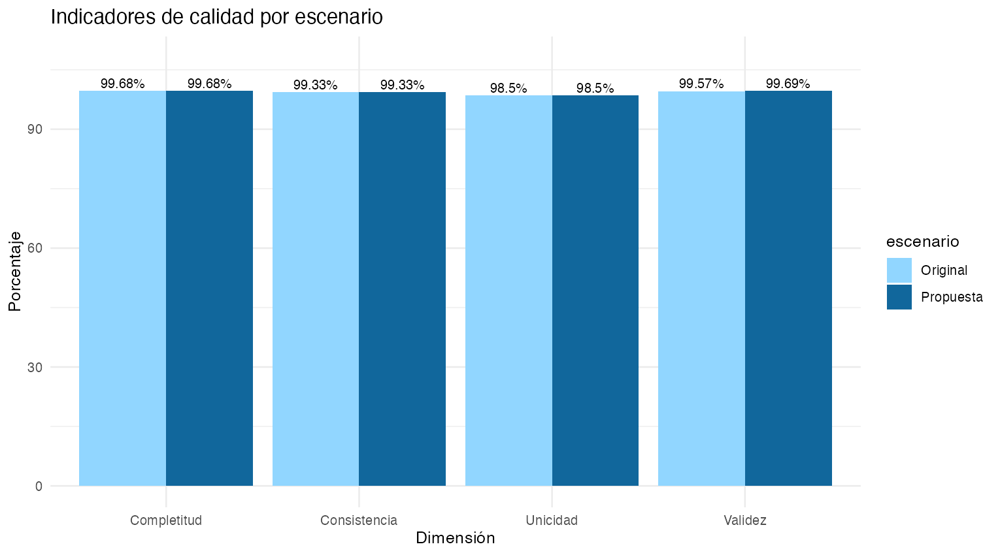
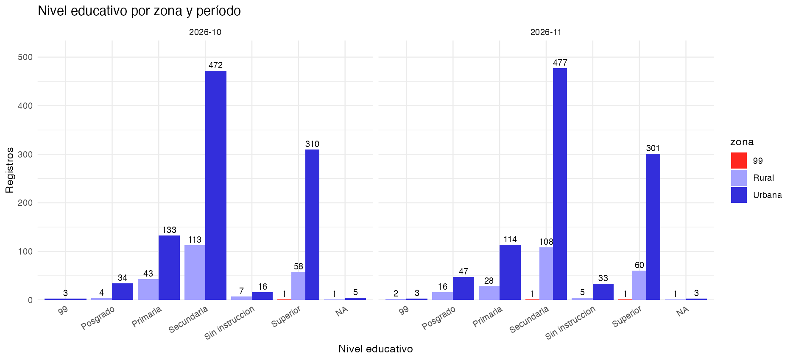
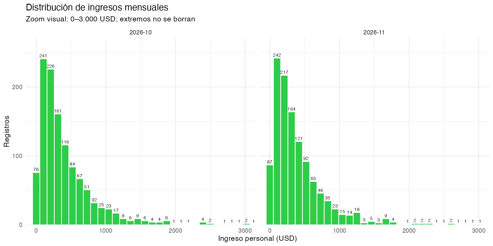
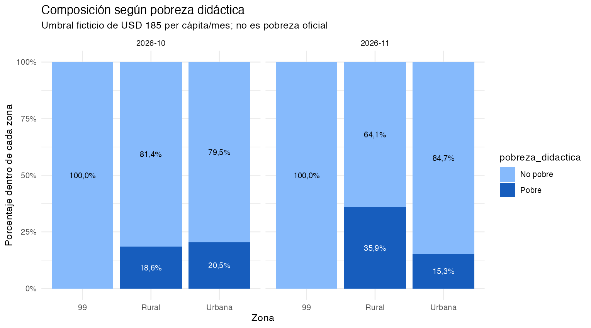
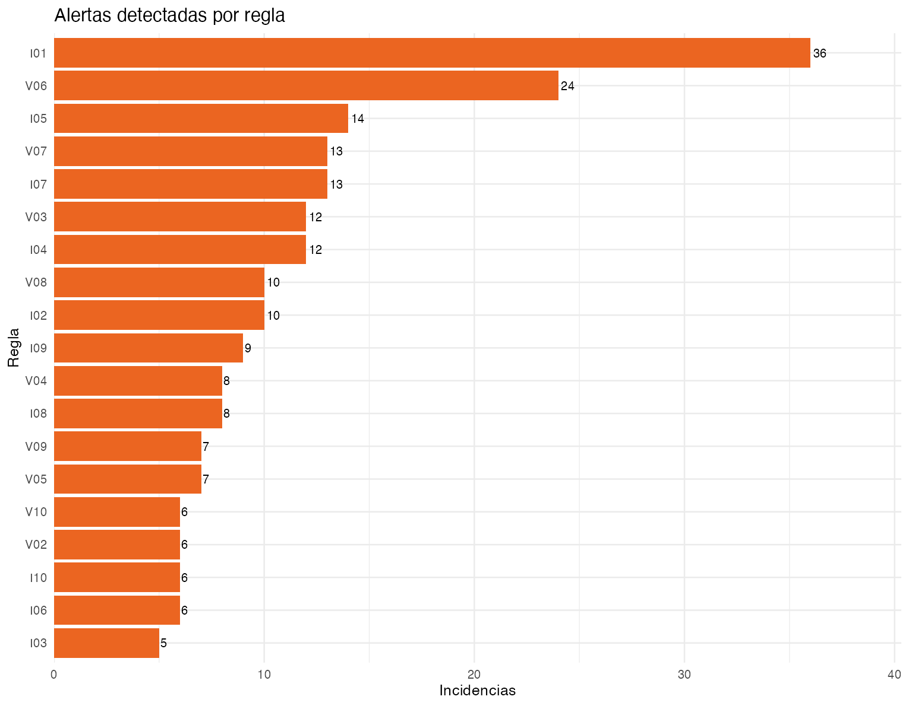

```{r}
library(here)
library(knitr)
library(dplyr)

# Identificar la raíz a partir de la ubicación de este documento.
here::i_am("web/index.qmd")

# Copiar las figuras dentro del proyecto web.
origen <- here::here("resultados", "figuras")
destino <- here::here("web", "figuras")

dir.create(destino, recursive = TRUE, showWarnings = FALSE)

archivos <- list.files(
  origen,
  pattern = "^06_.*\\.png$",
  full.names = TRUE
)

copiados <- file.copy(archivos, destino, overwrite = TRUE)
if (!length(archivos) || !all(copiados)) {
  stop("No se pudieron copiar todas las figuras al sitio.")
}

ruta <- here::here("resultados", "07_paquete_reporte.rds")

if (!file.exists(ruta)) {
  stop("No se encuentra el RDS en: ", ruta)
}

p <- readRDS(ruta)

```

**Advertencia:** datos totalmente ficticios y desbalanceados. No usar para estadísticas oficiales ni inferencias sobre la población ecuatoriana.

## Indicadores de calidad

```{r}
knitr::kable(p$tablas$indicadores, caption='Indicadores descriptivos del conjunto sintético')
```

```{r}

```

## Educación y territorio

```{r}

```

## Ingreso, pobreza didáctica e incidencias

```{r}



```

Los controles y figuras se calculan a partir del RDS. Consulte **Metodología** para conocer las definiciones, denominadores y advertencias.
